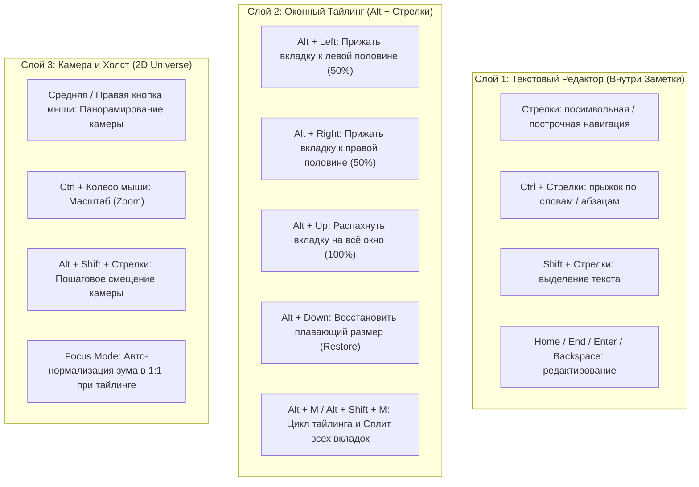

# Концепция и Архитектурный План: Навигация, Камера и Вкладки на Холсте

> [!NOTE]
> Данный документ формализует физику, иерархию слоёв ввода и взаимодействие «Камера — Холст — Вкладка» в архитектуре `asleep-pyqt`, исключая конфликты клавиатурных комбинаций при наборе текста.

---

## 1. Разделение Слоёв Ввода (Input Layer Hierarchy)

Главный закон эргономики текстового редактора: **набор и редактирование текста неприкосновенны**. 
В текстовом редакторе пользователь проводит 90% времени, поэтому шорткаты перемещения курсора по словам и строкам не должны перехватываться глобальным холстом.

---

## 2. Анализ комбинаций: почему `Ctrl + Стрелки` нельзя использовать для камеры?

### Стандарт ОС и Текстовых Процессоров:
1. **`Ctrl + Left`** / **`Ctrl + Right`**: стандартный прыжок курсора **по словам** (Word Jumping) в Windows, Linux, macOS и любом редакторе (VS Code, Notepad, Obsidian). Если повесить на эту комбинацию сдвиг камеры, пользователь не сможет редактировать код или текст привычным способом.
2. **`Ctrl + Up`** / **`Ctrl + Down`**: переход курсора **по абзацам** или прокрутка страницы на одну строку без смещения курсора.

### Решение для навигации камеры:
- Для **вкладки** используется: `Alt + Стрелки` (стандарт Windows Snap).
- Для **камеры** (если нужна клавиатура): `Alt + Shift + Стрелки` (панорамирование камеры на 1 шаг сетки или четверть экрана) либо классический нативный мышиный драг (средняя/правая кнопка мыши по фону).

---

## 3. Должна ли двигаться камера, когда вкладка открыта на всё окно?

Ответ: **НЕТ, камера блокируется (Focus Lock).**

### Почему:
1. Когда вкладка развёрнута на всё окно (`tileState === "full"`), пользователь вошёл в режим **глубокого фокуса (Zen / Monocle Mode)**.
2. Если в этот момент сдвинуть камеру, то:
   - Либо из-под развёрнутой вкладки покажется пустое тёмное поле холста (нарушится ощущение монолитного блокнота);
   - Либо вкладка будет «ездить» вместе с экраном, теряя привязку к физическим границам окна.
3. **Логика выхода**:
   - Чтобы снова обозревать холст, пользователь нажимает `Alt + Down` или `Alt + M` (или просто тянет за шапку мышкой) ➔ вкладка плавно уменьшается до своего размера на холсте, камера восстанавливает исходный зум обзора, и холст снова свободно панорамируется.

---

## 4. Сводная Таблица Взаимодействия (Matrix of Interactions)

| Действие | Инструмент / Клавиша | Поведение вкладки | Поведение камеры |
| :--- | :--- | :--- | :--- |
| **Редактирование** | `Стрелки`, `Ctrl + Стрелки` | Курсор бегает по тексту | Камера неподвижна |
| **Привязка влево** | `Alt + Left` | Занимает левые 50% экрана | Камера нормализуется в 1:1 (Focus) |
| **Привязка вправо** | `Alt + Right` | Занимает правые 50% экрана | Камера нормализуется в 1:1 (Focus) |
| **Во всё окно** | `Alt + Up` (или `Alt + M`) | Занимает 100% экрана | Камера в 1:1, панорамирование заблокировано |
| **Восстановить** | `Alt + Down` (или `Alt + M`) | Возврат в плавающий размер | Камера возвращает исходный зум обзора |
| **Сплит всех вкладок**| `Alt + Shift + M` | Раскладывает все вкладки (50/50, 33/33/33) | Камера в 1:1 |
| **Панорама холста** | `Мышь (СКМ / ПКМ)` | Вкладки остаются на своих координатах | Смещаются `panX`, `panY` |
| **Зум холста** | `Ctrl + Колесо мыши` | Масштабируются визуально | Изменяется `zoomScale` |
| **Сдвиг вкладки** | `ЛКМ за шапку` | Перемещается по холсту, магнитит к краям | Камера неподвижна (Правило 14) |

---

## 5. Аудит Соответствия Правилам (`asleep-pyqt.md`)

- [x] **Правило 1 (Локальный Монолит)**: Всё выполняется в рамках одного процесса `web.py` и нативного Basic стиля Qt Quick.
- [x] **Правило 5 (Config-First)**: Все клавиши объявлены в `config/default/hotkeys.json`, цвета и анимации берутся из `Theme.*`.
- [x] **Правило 11 (Сухой TXT Редактор)**: Текстовый редактор остаётся 100% монолитным блокнотом, стрелки и `Ctrl+Стрелки` не перегружаются сторонней логикой.
- [x] **Правило 12 (Sanity & KISS)**: Никаких сложных перехватов событий мыши или искусственных оверлеев. Всё построено на естественной геометрии Qt Quick.
- [x] **Правило 14 (Разделение движения)**: Вкладка перемещает строго саму себя (`panel.x`, `panel.y`). Холст перемещается только пользователем (СКМ/ПКМ или зум), за исключением явного Focus Mode тайлинга.
